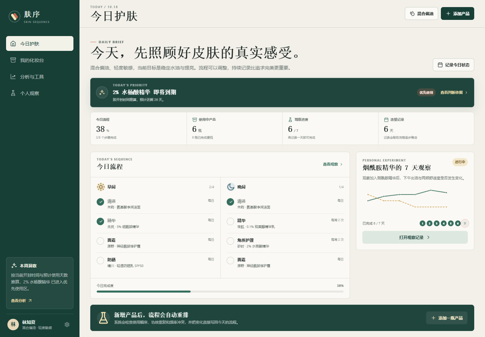
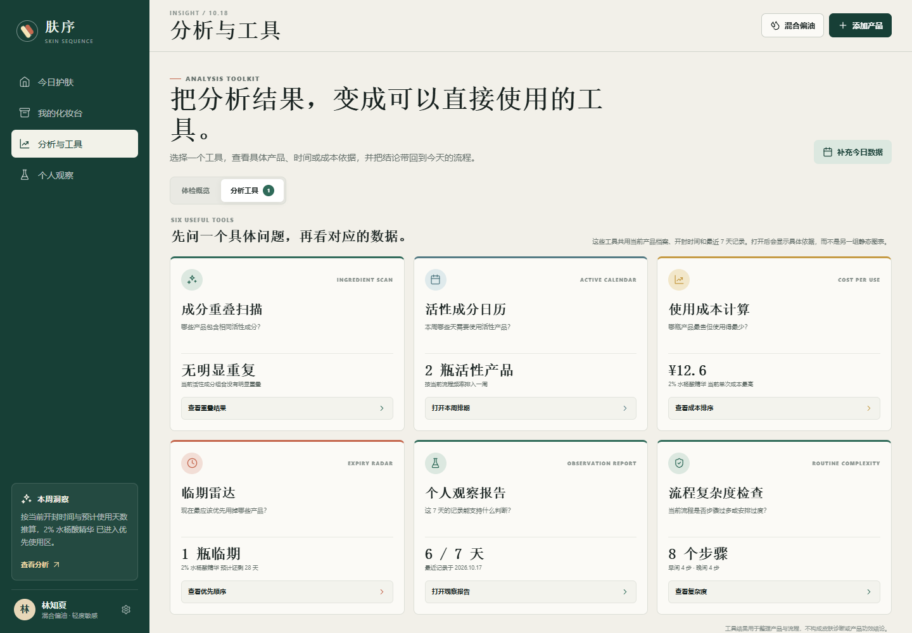

# 肤序 Fuxu

一个面向个人护肤流程的交互式产品原型，把产品成分、早晚流程、化妆台分析和 7 天个人观察连接成一条可回看的决策链路。

[在线 Demo](https://kikdco.github.io/fuxu/) · [GitHub Repository](https://github.com/kikdco/fuxu)

> 当前版本是前端交互原型，数据保存在浏览器 `localStorage`。它不是医疗器械，也不提供疾病诊断或产品功效保证。

## 项目亮点

- 从“看懂成分”继续走到“今天怎么做、做完怎么记录、记录后怎么调整”。
- 将成分重叠、临期风险、使用成本和流程复杂度拆成 6 个可用的小工具。
- 同时完成桌面端和移动端布局，并覆盖完整增删改查式交互。
- 明确区分规则判断、产品记录和个人主观观察，不把趋势包装成因果结论。

## 页面预览

| 今日护肤 | 分析与工具 |
| --- | --- |
|  |  |

## 核心功能

- 今日早晚流程、步骤打卡和完成度统计
- 产品录入、成分解析、产品详情和使用状态
- 化妆台分类筛选、开封时间与单次成本
- 组合结构分和六维体检概览
- 成分重叠扫描、活性成分日历、使用成本、临期雷达、观察报告和流程复杂度工具
- 7 天个人观察、每日状态记录和趋势图
- 个人肤质档案、示例数据和浏览器本地持久化

## 技术栈

- HTML5、CSS、原生 JavaScript
- `localStorage` 演示数据持久化
- Playwright 端到端测试
- GitHub Actions 持续集成
- GitHub Pages 静态部署

## 架构

```text
public/
  index.html       应用外壳
  app.js           页面渲染、交互和演示规则
  styles.css       响应式视觉系统
  favicon.svg      品牌图标
tests/
  smoke.spec.js    核心链路和移动端回归测试
scripts/
  serve.mjs        本地静态服务器
docs/
  product-spec.md  产品方案与规则设计
  architecture.md  当前架构与后续拆分方向
```

当前版本刻意保持无构建依赖，便于快速验证产品逻辑。下一阶段会将规则引擎、数据层和页面组件拆分，并接入真实后端。

## 本地运行

需要 Node.js 20 或更高版本。

```bash
npm install
npm run dev
```

访问 `http://127.0.0.1:4174/`。

## 测试

CI 使用 Playwright 自带的 Chromium：

```bash
npm install
npx playwright install chromium
npm test
```

如果本机已经安装 Google Chrome，可以使用：

```bash
$env:PLAYWRIGHT_CHANNEL="chrome"  # PowerShell
npm test
```

测试覆盖添加产品、成分详情、今日打卡、分析工具弹层、个人观察跳转和移动端横向溢出检查。

## 部署

仓库已配置 GitHub Pages 工作流，推送 `main` 后自动部署到：

<https://kikdco.github.io/fuxu/>

## 数据与安全边界

- 产品浓度和配方完整性未知时，不应输出确定性结论。
- 个人观察只用来展示主观记录和趋势，不宣称产品疗效或因果关系。
- 示例成分库和规则只用于验证交互，不应作为真实医疗或护肤建议。
- 当前数据仅保存在本机浏览器，清除站点数据会同时删除记录。

## 已知限制

- 还没有用户账号、云同步和跨设备数据。
- 规则和成分库仍是演示规模，缺少来源、审核和版本管理。
- 7 天观察还没有基础期和混杂因素记录。
- 还没有首次使用问卷、空状态和真实用户验证数据。

## 下一阶段

1. 完成首次使用流程、空状态和示例数据重置。
2. 拆分规则引擎与数据层，并补单元测试。
3. 接入 Supabase/PostgreSQL，完成账号、行级权限、导出和删除。
4. 用真实用户完成一轮可用性测试和 7 天试用。

更完整的产品定义见 [产品方案](./docs/product-spec.md)，技术取舍见 [架构说明](./docs/architecture.md)。

## License

[MIT](./LICENSE)
