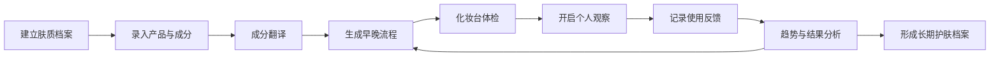

# 肤序

> 让每一套护肤流程，都有可回看的个人数据依据。

## 项目简介

肤序是一个面向个人用户的化妆品管理与护肤流程助手。

用户可以录入正在使用的化妆品，系统通过成分解析、规则判断和护肤记录，帮助用户完成以下事情：

- 看懂产品成分和主要功效
- 生成适合自己的早晚护肤流程
- 发现产品之间的重复、冲突和使用时间问题
- 用 7 天个人观察验证产品是否适合自己
- 分析产品使用率、空瓶周期和消费浪费

## 可运行交互原型

当前目录包含一版可直接运行的移动端优先 MVP 原型，覆盖以下完整链路：

- 今日早晚护肤流程与步骤打卡
- 产品分类筛选、添加产品与成分解析
- 产品详情、重复功效和流程冲突提示
- 体检概览与包含 6 个入口的分析工具箱
- 成分重叠扫描、活性成分日历、使用成本、临期雷达与流程复杂度检查
- 7 天个人观察、每日状态打卡与趋势报告
- 个人肤质档案编辑，以及浏览器本地数据持久化

在 `outputs` 目录运行：

```bash
python -m http.server 4174
```

然后访问 `http://127.0.0.1:4174/`。原型使用 `localStorage` 保存演示数据，不需要安装前端依赖或连接后端服务。

项目的核心不是提供一个“万能护肤答案”，而是建立一套可持续的循环：

> 生成建议 -> 执行流程 -> 记录反馈 -> 分析结果 -> 调整建议

## 项目背景

化妆品消费者通常面临以下问题：

- 成分信息专业、分散，普通用户很难快速理解
- 产品推荐往往来自达人、广告或他人经验，缺少个人反馈
- 多瓶产品叠加使用时，容易出现功效重复或刺激性叠加
- 用户经常忘记开封时间，造成产品过期和闲置
- 很多护肤建议只告诉用户“应该怎么做”，却没有验证是否真的适合

现有工具通常更擅长解决其中一个环节：

- 成分查询工具负责解释单个产品
- 社区内容负责提供他人经验
- 测肤工具负责给出一次性判断
- 电商平台负责产品推荐和购买

肤序希望把“理解产品、安排流程、观察反馈、调整方案”连接成一个完整闭环。

## 产品定位

**一句话定位：**

> 一个带个人实验功能的护肤流程助手。

**产品关键词：**

- 可解释：每条护肤建议都能说明原因
- 可验证：用户可以用自己的记录检验产品是否适合
- 可持续：帮助用户减少重复购买、闲置和过期浪费
- 可控：用户可以调整产品、频率和流程，不依赖单一算法结论

**产品边界：**

肤序提供化妆品信息整理、流程安排和个人使用趋势分析，不提供医疗诊断、疾病治疗或功效保证。

## 目标用户

### 核心用户

- 刚开始系统护肤，容易被成分和产品推荐困扰的人
- 同时使用多瓶护肤产品，经常忘记开封时间的人
- 对活性成分感兴趣，但不知道如何安排频率的人
- 想减少囤货、闲置和冲动消费的人

### 次级用户

- 需要整理家庭护肤产品的用户
- 对化妆品成分和配方有学习兴趣的人
- 需要记录产品使用体验的内容创作者
- 关注可持续消费和空瓶记录的人

## 核心使用场景

### 场景一：看懂一瓶产品

用户输入产品名称、品类和成分表，系统生成一张产品卡：

- 核心功效成分
- 保湿与修护成分
- 可能需要注意的成分
- 适合的护肤环节
- 与现有产品可能重复的部分

### 场景二：安排每天的护肤流程

用户完成肤质、目标和敏感程度设置后，系统根据现有产品生成：

- 早间流程
- 晚间流程
- 每周活性成分安排
- 新手使用频率建议
- 需要重点观察的步骤

### 场景三：检查整张化妆台

系统从功能覆盖、成分重复、刺激叠加、保质期、使用率和消费效率等维度生成化妆台体检报告。

### 场景四：验证产品是否适合

用户选择一个明确的问题开启个人观察，例如：

> 加入这瓶精华后，下午的出油情况是否发生变化？

系统安排观察周期，用户每天快速打卡，结束后生成个人趋势报告。

### 场景五：记录空瓶与消费

用户记录产品用完、停用或不再回购的原因，系统分析：

- 产品使用周期
- 单次使用成本
- 闲置比例
- 过期浪费
- 回购价值

## 核心闭环



## 创新点

### 1. 从“成分查询”升级为“流程决策”

普通成分工具回答“这瓶产品含什么”，肤序进一步回答：

- 这瓶产品在当前流程中承担什么角色？
- 应该放在早上还是晚上？
- 是否需要调整使用频率？
- 和现有产品是否功能重复？
- 新增这瓶产品后，整套流程发生了什么变化？

产品可以把新增产品前后的方案做成“流程变化卡”，让用户直接看到新增、移除、移动和降频的步骤。

### 2. 引入个人护肤实验

用户可以从一个明确的小问题开始，进行短周期观察：

- 新产品是否值得继续使用
- 某个步骤是否可以减少
- 更换使用频率后皮肤感受是否变化
- 某类产品是否存在重复购买

第一版采用 7 天观察，后续可扩展为“基础期 + 使用期”的对照记录。

实验报告展示趋势、使用依从率和数据完整度，不直接宣称产品疗效。

### 3. 规则引擎与 AI 分工

项目不建议把核心判断完全交给大模型。

更稳妥的分工是：

- 规则引擎负责流程顺序、成分重复、频率安排和风险等级
- 结构化成分库负责名称、别名、功效和标签
- AI 负责成分表解析、自然语言解释和用户反馈归纳
- 人工审核负责高风险信息和容易产生争议的护肤建议

这种方式既能提高可解释性，也能降低 AI 输出不稳定带来的风险。

### 4. 把可持续消费纳入护肤管理

项目不仅记录“用了什么”，还记录：

- 产品用了多久
- 实际使用次数
- 单次使用成本
- 是否闲置或过期
- 是否值得回购

这可以让产品同时服务于个人体验和可持续消费两个主题。

## MVP 范围

第一版只完成一条完整链路，不追求大而全。

### 必做功能

- 肤质与目标问卷
- 产品手动录入
- 成分表粘贴与基础解析
- 常见成分词典
- 产品详情卡
- 早晚流程生成
- 化妆台体检报告
- 7 天个人观察
- 每日快速打卡
- 趋势报告与调整建议

### 第一版暂不包含

- 虚拟试妆
- 人脸肤质识别
- 产品照片自动识别
- 社交社区
- 商城、支付和商品购买
- 复杂医学诊断
- 大规模商品数据库
- 复杂的统计显著性分析

## 页面结构

| 页面 | 主要作用 |
| --- | --- |
| 首页 / 今日护肤 | 展示今天早晚流程、实验进度和待办提醒 |
| 我的化妆台 | 按品类查看产品、使用状态和到期时间 |
| 添加产品 | 填写产品信息、粘贴成分表、设置开封时间 |
| 产品详情 | 查看成分翻译、产品角色、适用性和搭配提醒 |
| 化妆台体检 | 查看功能覆盖、成分重复、刺激叠加和消费效率 |
| 护肤实验 | 创建观察目标、每日打卡、查看趋势和结果 |
| 每周计划 | 查看一周内的活性成分安排和休息日 |
| 空瓶记录 | 记录空瓶、停用、闲置和回购意愿 |

如果开发时间有限，可以优先完成四个页面：

1. 肤质与目标问卷
2. 今日护肤流程
3. 产品详情与成分翻译
4. 化妆台体检

## 数据分析工具

数据分析工具必须回答具体问题，不能只是装饰性图表。

| 工具 | 回答的问题 | 推荐可视化 |
| --- | --- | --- |
| 化妆台体检 | 我的产品组合是否重复或失衡？ | 雷达图、分项评分 |
| 成分重叠矩阵 | 哪些产品包含相同功效成分？ | 热力图、矩阵图 |
| 活性成分日历 | 本周哪些天使用了活性成分？ | 周历、热力图 |
| 使用依从率 | 我是否真的在执行这套流程？ | 环形图、趋势线 |
| 7 天观察报告 | 使用新产品后，记录到的变化是什么？ | 折线图、前后对比卡 |
| 单次使用成本 | 哪瓶产品最贵但使用最少？ | 散点图、象限图 |
| 空瓶与浪费分析 | 哪些产品容易闲置或过期？ | 柱状图、分类统计 |

### 化妆台体检维度

- 功能覆盖：清洁、保湿、防晒和修护是否齐全
- 成分重复：是否存在同类功效成分堆积
- 刺激叠加：是否把多种活性成分安排在同一次流程
- 流程复杂度：步骤是否过多，是否容易坚持
- 保质期风险：哪些产品需要优先使用
- 使用效率：产品是否经常被使用
- 消费效率：单次使用成本是否合理

### 7 天观察指标

用户每天可以用 20 秒记录：

- 是否完成流程
- 出油程度
- 泛红程度
- 紧绷程度
- 爆痘或不适情况
- 产品使用感受
- 备注

报告优先展示：

- 趋势方向
- 数据完整度
- 使用依从率
- 不适记录
- 下一轮建议

报告中的建议使用“观察到”“可能与”“建议继续记录”等表达，避免将个人记录直接包装成医学结论。

## 核心规则设计

### 成分标准化

建立成分名称、别名和统一 ID，解决同一成分在不同产品中出现不同写法的问题。

### 成分角色标签

为成分添加结构化标签，例如：

- 清洁
- 保湿
- 修护
- 提亮
- 控油
- 去角质
- 防晒
- 香精或酒精等需要注意的信息

### 冲突等级

规则不建议只有“能用”和“不能用”两种结果，可以使用以下等级：

- `avoid`：建议避免在同一流程中使用
- `space-out`：可以都使用，但建议错开时间或日期
- `caution`：需要注意频率、耐受或皮肤反馈
- `duplicate`：功效重复，不一定有风险
- `info`：仅提供信息提示

每条规则应包含：

- 触发条件
- 风险说明
- 调整方式
- 适用人群
- 证据来源或内部维护说明

### 流程生成

流程生成优先遵循以下逻辑：

1. 保证基础步骤完整
2. 识别产品的主要护肤角色
3. 安排早晚使用时间
4. 检查成分重复和刺激叠加
5. 为用户保留手动调整空间
6. 根据使用反馈更新下一版方案

## 数据模型草案

| 实体 | 关键字段 |
| --- | --- |
| `UserProfile` | 肤质、敏感程度、目标、护肤经验、提醒设置 |
| `Product` | 品牌、名称、品类、成分表、图片、保质期 |
| `Ingredient` | 标准名称、别名、功效标签、注意事项 |
| `UserProduct` | 开封日期、状态、使用频率、回购意愿 |
| `RoutinePlan` | 早间步骤、晚间步骤、版本、生效时间 |
| `RoutineStep` | 产品、顺序、频率、使用时间 |
| `CheckIn` | 日期、完成情况、皮肤感受、备注 |
| `Experiment` | 观察目标、周期、变量、状态、结果 |
| `ConflictRule` | 成分 A、成分 B、等级、解释、调整建议 |
| `Insight` | 洞察内容、来源、关联数据、建议动作 |

## 技术方案建议

### 前端

- `Next.js` 或 `React`
- 移动端优先的响应式布局
- 图表可使用 `ECharts`、`Recharts` 或同类可视化库

### 数据层

- 原型阶段使用本地 JSON、CSV 或 `localStorage`
- 多用户阶段接入 `Supabase`、`Firebase` 或自建 API

### 规则层

- 先从结构化 JSON 规则开始
- 为成分、产品角色和冲突规则建立独立数据文件
- 将规则结果和 AI 解释分开保存，便于审核和复现

### AI 能力

AI 只作为辅助能力，适合处理：

- 非结构化成分表解析
- 专业术语转通俗语言
- 用户备注归纳
- 生成解释性文案

AI 不应独立决定：

- 医疗诊断
- 疾病治疗建议
- 高风险成分结论
- 未经审核的功效承诺

### 技术原则

- 所有建议尽量可解释
- 规则结果与生成文案解耦
- 用户数据默认私有
- 删除和导出路径清晰
- 先完成单条链路，再扩展数据库和模型

## 设计原则

- 首页直接进入“今日护肤”，不做营销式落地页
- 产品卡是核心视觉单元
- 信息密度适中，优先帮助用户快速判断
- 使用标签、矩阵、日历和趋势图辅助理解
- 不使用复杂的医学术语作为主要表达
- 所有风险提示标明等级和调整方法
- 移动端优先，适合每天快速记录

## 比赛展示方案

### 推荐主题

**精准护肤 + 可持续消费**

### 演示故事

1. 用户完成肤质和目标设置。
2. 用户添加三瓶现有产品。
3. 系统生成早晚流程，并提示两款产品存在成分重复。
4. 用户新增一瓶活性成分产品，系统展示流程变化和频率建议。
5. 用户开启 7 天个人观察。
6. 系统展示趋势、依从率、数据完整度和下一轮调整建议。
7. 用户查看化妆台体检与空瓶分析，发现重复购买和潜在浪费。

### 差异化表达

- 不只是成分查询，而是护肤流程决策
- 不只是一次性推荐，而是持续验证
- 不只是记录工具，而是个人数据反馈系统
- 不只关注产品功效，也关注使用效率和浪费

## 路线图

### 阶段一：概念与原型

- 完成项目定位和用户流程
- 建立页面清单和低保真线框
- 准备 30～50 个示例产品和 80～100 个常见成分
- 完成核心页面视觉稿

### 阶段二：MVP

- 完成肤质问卷
- 完成产品录入和产品详情
- 完成早晚流程生成
- 完成化妆台体检
- 完成 7 天个人观察

### 阶段三：验证

- 邀请 3～5 名真实用户试用
- 观察用户是否愿意录入第 2、第 3 瓶产品
- 观察 7 天观察功能的完成率
- 收集用户对建议可理解性的反馈
- 根据反馈调整规则和页面

### 阶段四：扩展

- 增加空瓶和消费分析
- 增加条码或图片识别
- 增加更丰富的成分库
- 增加长期趋势和护肤档案
- 探索多用户和家庭共享场景

## 验证指标

首轮测试建议关注以下指标：

- 完成肤质设置的用户比例
- 平均录入产品数量
- 7 天观察完成率
- 每日打卡完成率
- 用户是否能理解产品卡上的结论
- 用户是否根据提示调整了使用频率
- 用户是否减少了重复购买或过期浪费
- 用户是否愿意再次使用流程生成功能

这些指标用于验证产品是否真正帮助用户做出决策，而不仅仅是获得了多少次点击。

## 风险与边界

| 风险 | 应对方式 |
| --- | --- |
| 成分数据不准确 | 建立审核流程，标注数据来源和更新时间 |
| 产品浓度和配方差异 | 用“可能”“建议观察”等表达，不只看单个成分下结论 |
| 个人记录偏差 | 展示数据完整度和依从率，不宣称医学疗效 |
| AI 输出不稳定 | 规则结果与文案生成分离，保留人工审核 |
| 产品图片和成分版权 | 优先使用用户自有数据、公开授权数据或示例数据 |
| 用户隐私 | 默认不要求上传人脸照片，支持导出和删除个人数据 |

## 项目愿景

肤序希望把护肤建议从“别人说好用”，逐步转变为“我知道它为什么适合我，也知道我该如何验证”。

长期来看，它可以成为用户的个人护肤档案，也可以为化妆品行业提供一种更透明、更可持续的产品使用方式。

---

**当前阶段：概念设计 / MVP 规划**
